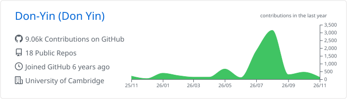
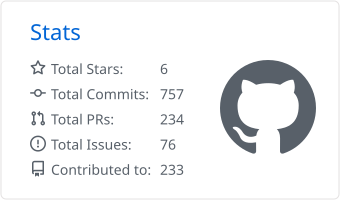
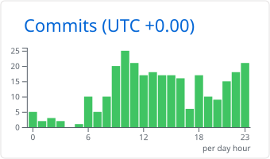

🔭 I’m working on understanding the mechanism behind human brain resilience against cognitive decline using machine learning, multimodal deep learning and some principles from complex systems.
📫 How to reach me: click [here](https://don-yin.uk)

  
  

  
  

  <picture>
    <source media="(prefers-color-scheme: dark)" srcset="https://raw.githubusercontent.com/Don-Yin/Don-Yin/output/github-snake-dark.svg" />
    
  </picture>

<!-- pr-stats:start -->

<a href="https://github.com/Don-Yin/github-pr-stats-cards"><picture><source media="(max-width: 600px)" srcset="./metrics/pr-stats-narrow.svg#heading" width="368"></picture></a> 
<a href="https://github.com/apmantza/pi-lens/pulls?q=is%3Apr%20is%3Amerged%20author%3ADon-Yin"><picture><source media="(max-width: 600px)" srcset="./metrics/pr-stats-narrow.svg#r-apmantza--pi-lens" width="368"></picture></a><a href="https://github.com/diceframe/diceframe/pulls?q=is%3Apr%20is%3Amerged%20author%3ADon-Yin"><picture><source media="(max-width: 600px)" srcset="./metrics/pr-stats-narrow.svg#r-diceframe--diceframe" width="368"></picture></a> 
<a href="https://github.com/mindset-vision/mindset-vision/pulls?q=is%3Apr%20is%3Amerged%20author%3ADon-Yin"><picture><source media="(max-width: 600px)" srcset="./metrics/pr-stats-narrow.svg#r-mindset-vision--mindset-vision" width="368"></picture></a><a href="https://github.com/postcss/postcss/pulls?q=is%3Apr%20is%3Amerged%20author%3ADon-Yin"><picture><source media="(max-width: 600px)" srcset="./metrics/pr-stats-narrow.svg#r-postcss--postcss" width="368"></picture></a> 
<a href="https://github.com/saghen/blink.cmp/pulls?q=is%3Apr%20is%3Amerged%20author%3ADon-Yin"><picture><source media="(max-width: 600px)" srcset="./metrics/pr-stats-narrow.svg#r-saghen--blink.cmp" width="368"></picture></a><a href="https://github.com/jgm/texmath/pulls?q=is%3Apr%20is%3Amerged%20author%3ADon-Yin"><picture><source media="(max-width: 600px)" srcset="./metrics/pr-stats-narrow.svg#r-jgm--texmath" width="368"></picture></a> 
<a href="https://github.com/miltonllera/mindset-eval/pulls?q=is%3Apr%20is%3Amerged%20author%3ADon-Yin"><picture><source media="(max-width: 600px)" srcset="./metrics/pr-stats-narrow.svg#r-miltonllera--mindset-eval" width="368"></picture></a><a href="https://github.com/Leaflet/Leaflet/pulls?q=is%3Apr%20is%3Amerged%20author%3ADon-Yin"><picture><source media="(max-width: 600px)" srcset="./metrics/pr-stats-narrow.svg#r-Leaflet--Leaflet" width="368"></picture></a> 
<a href="https://github.com/koalaman/shellcheck/pulls?q=is%3Apr%20is%3Amerged%20author%3ADon-Yin"><picture><source media="(max-width: 600px)" srcset="./metrics/pr-stats-narrow.svg#r-koalaman--shellcheck" width="368"></picture></a><a href="https://github.com/statsmodels/statsmodels/pulls?q=is%3Apr%20is%3Amerged%20author%3ADon-Yin"><picture><source media="(max-width: 600px)" srcset="./metrics/pr-stats-narrow.svg#r-statsmodels--statsmodels" width="368"></picture></a> 
<a href="https://github.com/sinclairzx81/typebox/pulls?q=is%3Apr%20is%3Amerged%20author%3ADon-Yin"><picture><source media="(max-width: 600px)" srcset="./metrics/pr-stats-narrow.svg#r-sinclairzx81--typebox" width="368"></picture></a><a href="https://github.com/MakieOrg/Makie.jl/pulls?q=is%3Apr%20is%3Amerged%20author%3ADon-Yin"><picture><source media="(max-width: 600px)" srcset="./metrics/pr-stats-narrow.svg#r-MakieOrg--Makie.jl" width="368"></picture></a> 
<a href="https://github.com/academa-labs/manimgx/pulls?q=is%3Apr%20is%3Amerged%20author%3ADon-Yin"><picture><source media="(max-width: 600px)" srcset="./metrics/pr-stats-narrow.svg#r-academa-labs--manimgx" width="368"></picture></a><a href="https://github.com/Project-MONAI/tutorials/pulls?q=is%3Apr%20is%3Amerged%20author%3ADon-Yin"><picture><source media="(max-width: 600px)" srcset="./metrics/pr-stats-narrow.svg#r-Project-MONAI--tutorials" width="368"></picture></a> 
<a href="https://github.com/yoanbernabeu/grepai/pulls?q=is%3Apr%20is%3Amerged%20author%3ADon-Yin"><picture><source media="(max-width: 600px)" srcset="./metrics/pr-stats-narrow.svg#r-yoanbernabeu--grepai" width="368"></picture></a><a href="https://github.com/paupino/rust-decimal/pulls?q=is%3Apr%20is%3Amerged%20author%3ADon-Yin"><picture><source media="(max-width: 600px)" srcset="./metrics/pr-stats-narrow.svg#r-paupino--rust-decimal" width="368"></picture></a> 
<a href="https://github.com/MIC-DKFZ/batchgenerators/pulls?q=is%3Apr%20is%3Amerged%20author%3ADon-Yin"><picture><source media="(max-width: 600px)" srcset="./metrics/pr-stats-narrow.svg#r-MIC-DKFZ--batchgenerators" width="368"></picture></a><a href="https://github.com/Swatinem/rollup-plugin-dts/pulls?q=is%3Apr%20is%3Amerged%20author%3ADon-Yin"><picture><source media="(max-width: 600px)" srcset="./metrics/pr-stats-narrow.svg#r-Swatinem--rollup-plugin-dts" width="368"></picture></a> 
<a href="https://github.com/dipy/dipy/pulls?q=is%3Apr%20is%3Amerged%20author%3ADon-Yin"><picture><source media="(max-width: 600px)" srcset="./metrics/pr-stats-narrow.svg#r-dipy--dipy" width="368"></picture></a><a href="https://github.com/nipy/nibabel/pulls?q=is%3Apr%20is%3Amerged%20author%3ADon-Yin"><picture><source media="(max-width: 600px)" srcset="./metrics/pr-stats-narrow.svg#r-nipy--nibabel" width="368"></picture></a> 
<a href="https://github.com/pydantic/pydantic-extra-types/pulls?q=is%3Apr%20is%3Amerged%20author%3ADon-Yin"><picture><source media="(max-width: 600px)" srcset="./metrics/pr-stats-narrow.svg#r-pydantic--pydantic-extra-types" width="368"></picture></a><a href="https://github.com/ome/ome-zarr-py/pulls?q=is%3Apr%20is%3Amerged%20author%3ADon-Yin"><picture><source media="(max-width: 600px)" srcset="./metrics/pr-stats-narrow.svg#r-ome--ome-zarr-py" width="368"></picture></a> 
<a href="https://github.com/jgm/citeproc/pulls?q=is%3Apr%20is%3Amerged%20author%3ADon-Yin"><picture><source media="(max-width: 600px)" srcset="./metrics/pr-stats-narrow.svg#r-jgm--citeproc" width="368"></picture></a><a href="https://github.com/mne-tools/mne-connectivity/pulls?q=is%3Apr%20is%3Amerged%20author%3ADon-Yin"><picture><source media="(max-width: 600px)" srcset="./metrics/pr-stats-narrow.svg#r-mne-tools--mne-connectivity" width="368"></picture></a> 
<a href="https://github.com/fastfetch-cli/fastfetch/pulls?q=is%3Apr%20is%3Amerged%20author%3ADon-Yin"><picture><source media="(max-width: 600px)" srcset="./metrics/pr-stats-narrow.svg#r-fastfetch-cli--fastfetch" width="368"></picture></a><a href="https://github.com/shikijs/shiki/pulls?q=is%3Apr%20is%3Amerged%20author%3ADon-Yin"><picture><source media="(max-width: 600px)" srcset="./metrics/pr-stats-narrow.svg#r-shikijs--shiki" width="368"></picture></a> 
<a href="https://github.com/rubocop/rubocop/pulls?q=is%3Apr%20is%3Amerged%20author%3ADon-Yin"><picture><source media="(max-width: 600px)" srcset="./metrics/pr-stats-narrow.svg#r-rubocop--rubocop" width="368"></picture></a><a href="https://github.com/py-pdf/pypdf/pulls?q=is%3Apr%20is%3Amerged%20author%3ADon-Yin"><picture><source media="(max-width: 600px)" srcset="./metrics/pr-stats-narrow.svg#r-py-pdf--pypdf" width="368"></picture></a> 
<a href="https://github.com/polakowo/vectorbt/pulls?q=is%3Apr%20is%3Amerged%20author%3ADon-Yin"><picture><source media="(max-width: 600px)" srcset="./metrics/pr-stats-narrow.svg#r-polakowo--vectorbt" width="368"></picture></a><a href="https://github.com/lmcinnes/umap/pulls?q=is%3Apr%20is%3Amerged%20author%3ADon-Yin"><picture><source media="(max-width: 600px)" srcset="./metrics/pr-stats-narrow.svg#r-lmcinnes--umap" width="368"></picture></a> 
<a href="https://github.com/davidhalter/jedi/pulls?q=is%3Apr%20is%3Amerged%20author%3ADon-Yin"><picture><source media="(max-width: 600px)" srcset="./metrics/pr-stats-narrow.svg#r-davidhalter--jedi" width="368"></picture></a><a href="https://github.com/fonttools/fonttools/pulls?q=is%3Apr%20is%3Amerged%20author%3ADon-Yin"><picture><source media="(max-width: 600px)" srcset="./metrics/pr-stats-narrow.svg#r-fonttools--fonttools" width="368"></picture></a> 
<a href="https://github.com/crossterm-rs/crossterm/pulls?q=is%3Apr%20is%3Amerged%20author%3ADon-Yin"><picture><source media="(max-width: 600px)" srcset="./metrics/pr-stats-narrow.svg#r-crossterm-rs--crossterm" width="368"></picture></a><a href="https://github.com/mikedh/trimesh/pulls?q=is%3Apr%20is%3Amerged%20author%3ADon-Yin"><picture><source media="(max-width: 600px)" srcset="./metrics/pr-stats-narrow.svg#r-mikedh--trimesh" width="368"></picture></a> 
<a href="https://github.com/jedib0t/go-pretty/pulls?q=is%3Apr%20is%3Amerged%20author%3ADon-Yin"><picture><source media="(max-width: 600px)" srcset="./metrics/pr-stats-narrow.svg#r-jedib0t--go-pretty" width="368"></picture></a><a href="https://github.com/rstudio/rmarkdown/pulls?q=is%3Apr%20is%3Amerged%20author%3ADon-Yin"><picture><source media="(max-width: 600px)" srcset="./metrics/pr-stats-narrow.svg#r-rstudio--rmarkdown" width="368"></picture></a> 
<a href="https://github.com/ccache/ccache/pulls?q=is%3Apr%20is%3Amerged%20author%3ADon-Yin"><picture><source media="(max-width: 600px)" srcset="./metrics/pr-stats-narrow.svg#r-ccache--ccache" width="368"></picture></a><a href="https://github.com/trentm/python-markdown2/pulls?q=is%3Apr%20is%3Amerged%20author%3ADon-Yin"><picture><source media="(max-width: 600px)" srcset="./metrics/pr-stats-narrow.svg#r-trentm--python-markdown2" width="368"></picture></a> 
<a href="https://github.com/zhiburt/tabled/pulls?q=is%3Apr%20is%3Amerged%20author%3ADon-Yin"><picture><source media="(max-width: 600px)" srcset="./metrics/pr-stats-narrow.svg#r-zhiburt--tabled" width="368"></picture></a><a href="https://github.com/gookit/goutil/pulls?q=is%3Apr%20is%3Amerged%20author%3ADon-Yin"><picture><source media="(max-width: 600px)" srcset="./metrics/pr-stats-narrow.svg#r-gookit--goutil" width="368"></picture></a> 
<a href="https://github.com/h5py/h5py/pulls?q=is%3Apr%20is%3Amerged%20author%3ADon-Yin"><picture><source media="(max-width: 600px)" srcset="./metrics/pr-stats-narrow.svg#r-h5py--h5py" width="368"></picture></a><a href="https://github.com/stefan-jansen/zipline-reloaded/pulls?q=is%3Apr%20is%3Amerged%20author%3ADon-Yin"><picture><source media="(max-width: 600px)" srcset="./metrics/pr-stats-narrow.svg#r-stefan-jansen--zipline-reloaded" width="368"></picture></a> 
<a href="https://github.com/JuliaPlots/Plots.jl/pulls?q=is%3Apr%20is%3Amerged%20author%3ADon-Yin"><picture><source media="(max-width: 600px)" srcset="./metrics/pr-stats-narrow.svg#r-JuliaPlots--Plots.jl" width="368"></picture></a><a href="https://github.com/cetz-package/cetz/pulls?q=is%3Apr%20is%3Amerged%20author%3ADon-Yin"><picture><source media="(max-width: 600px)" srcset="./metrics/pr-stats-narrow.svg#r-cetz-package--cetz" width="368"></picture></a> 
<a href="https://github.com/metosin/malli/pulls?q=is%3Apr%20is%3Amerged%20author%3ADon-Yin"><picture><source media="(max-width: 600px)" srcset="./metrics/pr-stats-narrow.svg#r-metosin--malli" width="368"></picture></a><a href="https://github.com/metosin/reitit/pulls?q=is%3Apr%20is%3Amerged%20author%3ADon-Yin"><picture><source media="(max-width: 600px)" srcset="./metrics/pr-stats-narrow.svg#r-metosin--reitit" width="368"></picture></a> 
<a href="https://github.com/nim-lang/nimble/pulls?q=is%3Apr%20is%3Amerged%20author%3ADon-Yin"><picture><source media="(max-width: 600px)" srcset="./metrics/pr-stats-narrow.svg#r-nim-lang--nimble" width="368"></picture></a><a href="https://github.com/BrianPugh/cyclopts/pulls?q=is%3Apr%20is%3Amerged%20author%3ADon-Yin"><picture><source media="(max-width: 600px)" srcset="./metrics/pr-stats-narrow.svg#r-BrianPugh--cyclopts" width="368"></picture></a> 
<a href="https://github.com/elixir-ecto/postgrex/pulls?q=is%3Apr%20is%3Amerged%20author%3ADon-Yin"><picture><source media="(max-width: 600px)" srcset="./metrics/pr-stats-narrow.svg#r-elixir-ecto--postgrex" width="368"></picture></a><a href="https://github.com/console-rs/console/pulls?q=is%3Apr%20is%3Amerged%20author%3ADon-Yin"><picture><source media="(max-width: 600px)" srcset="./metrics/pr-stats-narrow.svg#r-console-rs--console" width="368"></picture></a> 
<a href="https://github.com/facelessuser/pymdown-extensions/pulls?q=is%3Apr%20is%3Amerged%20author%3ADon-Yin"><picture><source media="(max-width: 600px)" srcset="./metrics/pr-stats-narrow.svg#r-facelessuser--pymdown-extensions" width="368"></picture></a><a href="https://github.com/PyCQA/flake8-bugbear/pulls?q=is%3Apr%20is%3Amerged%20author%3ADon-Yin"><picture><source media="(max-width: 600px)" srcset="./metrics/pr-stats-narrow.svg#r-PyCQA--flake8-bugbear" width="368"></picture></a> 
<a href="https://github.com/senstella/parakeet-mlx/pulls?q=is%3Apr%20is%3Amerged%20author%3ADon-Yin"><picture><source media="(max-width: 600px)" srcset="./metrics/pr-stats-narrow.svg#r-senstella--parakeet-mlx" width="368"></picture></a><a href="https://github.com/lmcinnes/pynndescent/pulls?q=is%3Apr%20is%3Amerged%20author%3ADon-Yin"><picture><source media="(max-width: 600px)" srcset="./metrics/pr-stats-narrow.svg#r-lmcinnes--pynndescent" width="368"></picture></a> 
<a href="https://github.com/radashi-org/radashi/pulls?q=is%3Apr%20is%3Amerged%20author%3ADon-Yin"><picture><source media="(max-width: 600px)" srcset="./metrics/pr-stats-narrow.svg#r-radashi-org--radashi" width="368"></picture></a><a href="https://github.com/Bachmann1234/diff_cover/pulls?q=is%3Apr%20is%3Amerged%20author%3ADon-Yin"><picture><source media="(max-width: 600px)" srcset="./metrics/pr-stats-narrow.svg#r-Bachmann1234--diff_cover" width="368"></picture></a> 
<a href="https://github.com/nushell/reedline/pulls?q=is%3Apr%20is%3Amerged%20author%3ADon-Yin"><picture><source media="(max-width: 600px)" srcset="./metrics/pr-stats-narrow.svg#r-nushell--reedline" width="368"></picture></a><a href="https://github.com/mappu/miqt/pulls?q=is%3Apr%20is%3Amerged%20author%3ADon-Yin"><picture><source media="(max-width: 600px)" srcset="./metrics/pr-stats-narrow.svg#r-mappu--miqt" width="368"></picture></a> 
<a href="https://github.com/antchfx/xpath/pulls?q=is%3Apr%20is%3Amerged%20author%3ADon-Yin"><picture><source media="(max-width: 600px)" srcset="./metrics/pr-stats-narrow.svg#r-antchfx--xpath" width="368"></picture></a><a href="https://github.com/ocaml-ppx/ocamlformat/pulls?q=is%3Apr%20is%3Amerged%20author%3ADon-Yin"><picture><source media="(max-width: 600px)" srcset="./metrics/pr-stats-narrow.svg#r-ocaml-ppx--ocamlformat" width="368"></picture></a> 
<a href="https://github.com/lme4/lme4/pulls?q=is%3Apr%20is%3Amerged%20author%3ADon-Yin"><picture><source media="(max-width: 600px)" srcset="./metrics/pr-stats-narrow.svg#r-lme4--lme4" width="368"></picture></a><a href="https://github.com/PyLops/pylops/pulls?q=is%3Apr%20is%3Amerged%20author%3ADon-Yin"><picture><source media="(max-width: 600px)" srcset="./metrics/pr-stats-narrow.svg#r-PyLops--pylops" width="368"></picture></a> 
<a href="https://github.com/ucl-pond/pySuStaIn/pulls?q=is%3Apr%20is%3Amerged%20author%3ADon-Yin"><picture><source media="(max-width: 600px)" srcset="./metrics/pr-stats-narrow.svg#r-ucl-pond--pySuStaIn" width="368"></picture></a><a href="https://github.com/jgm/djot.js/pulls?q=is%3Apr%20is%3Amerged%20author%3ADon-Yin"><picture><source media="(max-width: 600px)" srcset="./metrics/pr-stats-narrow.svg#r-jgm--djot.js" width="368"></picture></a> 
<a href="https://github.com/scikit-hep/hist/pulls?q=is%3Apr%20is%3Amerged%20author%3ADon-Yin"><picture><source media="(max-width: 600px)" srcset="./metrics/pr-stats-narrow.svg#r-scikit-hep--hist" width="368"></picture></a><a href="https://github.com/rspec/rspec/pulls?q=is%3Apr%20is%3Amerged%20author%3ADon-Yin"><picture><source media="(max-width: 600px)" srcset="./metrics/pr-stats-narrow.svg#r-rspec--rspec" width="368"></picture></a> 

<!-- pr-stats:end -->

  <picture>
    <source media="(prefers-color-scheme: dark)" srcset="./profile-summary-card-output/github_dark/0-profile-details.svg" />
    
  </picture>

  <picture>
    <source media="(prefers-color-scheme: dark)" srcset="./profile-summary-card-output/github_dark/3-stats.svg" />
    
  </picture>
  <picture>
    <source media="(prefers-color-scheme: dark)" srcset="./profile-summary-card-output/github_dark/4-productive-time.svg" />
    
  </picture>
  <picture>
    <source media="(prefers-color-scheme: dark)" srcset="./profile-summary-card-output/github_dark/1-repos-per-language.svg" />
    
  </picture>
  <picture>
    <source media="(prefers-color-scheme: dark)" srcset="./profile-summary-card-output/github_dark/2-most-commit-language.svg" />
    
  </picture>

  <picture>
    <source media="(prefers-color-scheme: dark)" srcset="https://streak-stats.demolab.com?user=Don-Yin&theme=github-dark-blue&hide_border=true" />
    
  </picture>

